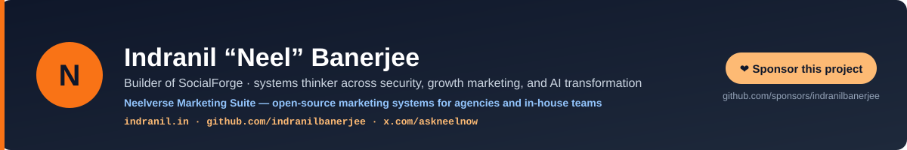

# SocialForge — Social Media Calendar Automation

> **Your client wants 30 days of social content across six platforms with brand-faithful imagery, AI-generated video, and provenance signed for EU markets. You have five days. The last calendar got rejected because the product photo got "AI-enhanced" beyond recognition.**

Run `/socialforge:new-month` → `/socialforge:generate-all` → `/socialforge:review`. Asset-first compositing keeps brand photos pixel-faithful while AI generates the scene around them. Per-platform copy adaptation handles Instagram + TikTok + LinkedIn + Threads + X + Facebook + YouTube Shorts in one pass. C2PA signing happens before review. No more "AI enhanced our logo into something else" disasters.

Open-source agency-grade social media production engine — **21 skills · 18 commands · 5 agents · 30 scripts · an opt-in catalog of 12 HTTP connectors (zero auto-connected) · 0 global hooks**. AI image (Vertex AI) and AI video (WaveSpeed), with models resolved live rather than hardcoded, and human-in-the-loop review galleries. Built for agencies and in-house teams running monthly content calendars. Installs on **Claude Code** (CLI + IDE), **Anthropic Cowork**, **OpenAI Codex**, **Cursor 2.5+**, **GitHub Copilot CLI**, **Google Antigravity 2.0**, **Hermes Agent**, **OpenClaw**, and **Grok** + 35+ Agent Skills platforms. Created by [Indranil Banerjee](https://indranil.in) · [LinkedIn](https://www.linkedin.com/in/askneelnow/) · [X](https://x.com/askneelnow).

[](CHANGELOG.md)
[](LICENSE)
[](https://github.com/indranilbanerjee/socialforge/stargazers)
[](tests/)
[](#supported-surfaces-v1296)
[](references/c2pa-production-cert.md)

[](https://github.com/sponsors/indranilbanerjee)

> 🆕 **Just shipped — v1.29.6 (October 12, 2026): a printed command works pasted into Git Bash and PowerShell, and a failed script no longer exits 0.** [Current release](#current-release-v1296) · [Changelog](CHANGELOG.md)

```bash
# Install in Claude Code:
/plugin marketplace add indranilbanerjee/neels-plugins
/plugin install socialforge@neels-plugins

# Install on Hermes Agent (Nous Research):
hermes plugins install indranilbanerjee/socialforge

# Install on OpenClaw:
openclaw plugins install git:github.com/indranilbanerjee/socialforge

# Install on Grok (xAI Build CLI):
grok plugin install indranilbanerjee/socialforge
```

> If SocialForge saves your team time, [give it a star ⭐](https://github.com/indranilbanerjee/socialforge/stargazers) — it's the single thing that helps other agencies find it.

## Try this first

Install, run the one-time setup, then ask in plain words. Each of these kinds of request reached the right skill in our trigger tests.

| You type | What happens |
|---|---|
| "load this month's calendar" | Your calendar (DOCX, XLSX, Notion or pasted text) parsed into structured posts |
| "make the visual for this post" | The creative for one post: your brand photos kept faithful, AI image or video where needed, quoted before any paid call |
| "rewrite this caption for LinkedIn" | Copy adapted to the platform: character limits, hashtags, tone and the right call to action |
| "show how this will look" | A preview card per platform (post copy, image, platform badge) to check copy and crop before publishing; it shows the scope and waits for your `yes` |
| "produce the whole month" | The full pipeline from calendar to delivery, pausing for asset confirmation, the price quote and client review |
| "package the month for the client" | The delivery folder with copy files and a manifest, after a delivery audit; it waits for your `yes` |

### What SocialForge will never do

- **Spend on image or video generation before you see the price.** It quotes each paid item from a live price lookup and waits for "go"; anything else cancels.
- **Install a package or a browser on its own.** Setup shows what is missing and installs only when you say so.
- **Ask for an API key in the chat.** Keys come from environment variables.
- **Package or send the month without your `yes`,** and never before the client review (a typed `--force` is logged and flagged by the delivery audit).
- **Connect a service you did not set up.** No MCP server ships enabled and no hooks run.
- **Remove or hide AI watermarks.** AI involvement is disclosed, with C2PA provenance.

### What it costs

- **The plugin is free** (MIT-licensed).
- **Model usage (tokens).** On a subscription (Claude Pro, Max, Team or Enterprise in Claude Code or Cowork; a ChatGPT plan in Codex; a Cursor or Copilot plan; the same goes for other hosts' plans) the tokens count against your plan's usage limits instead of being billed per token; check your plan for any optional extra-usage billing. Only pay-as-you-go API-key users pay per token. Context (the skill listing, a skill's instructions, the images it reads) uses context window and usage allowance for everyone, and money only for API users.
- **Image and video generation is billed by the provider you connect with your own key** (Vertex AI, WaveSpeed, HiggsField), whatever Claude, ChatGPT or Cursor plan you are on. That is what the price quote before "go" is for: it shows each paid item's live price, its source and its age before anything is generated.

## How it works

Agency-grade social media calendar automation with asset-first compositing and AI video generation. Takes monthly content calendars, matches brand assets, generates AI-composed creative, renders carousels, produces AI-generated video clips, adapts copy per platform, produces review galleries and delivery documents — with C2PA content provenance signed into every AI-generated image/video before delivery.


The amber steps are yours: nothing is spent before the quote is approved, and nothing is packaged before the client review.

**A real preview.** Rendered by this release's copy adapter and preview renderer from the verified facts and chart of the link-rot article of a documented real run (August 2026): no AI generation, no credits spent.


## Quick Start

1. **Install.** In Claude Code:

   ```
   /plugin marketplace add indranilbanerjee/neels-plugins
   /plugin install socialforge@neels-plugins
   ```

   In Cowork, use the Plugins panel instead (Add marketplace, paste `indranilbanerjee/neels-plugins`, Install SocialForge); `/plugin` commands work only in Claude Code. Other hosts are under [Supported surfaces](#supported-surfaces-v1296).
2. **Connect image and video generation (one time).** Run `/socialforge:setup`. Your admin gives you a Google Cloud service-account JSON key file (Vertex AI, images) and a WaveSpeed API key (video). Setup lists any missing Python packages with the exact pinned install command and installs only after you say `yes`; you point it at the key file and set `WAVESPEED_API_KEY` in your environment, and never paste a key into the chat. It stores the credentials in `${CLAUDE_PLUGIN_DATA}`, so they last across sessions. Without this step image and video generation will not work; everything else (calendar parsing, copy adaptation, review galleries) runs normally. Check it with `/socialforge:status`. No accounts yet? See [Admin Setup](#admin-setup-one-time).
3. `/socialforge:brand-setup [brand-name]` configures the brand (5-10 min).
4. `/socialforge:index-assets [brand-name]` indexes the brand photo library.
5. `/socialforge:new-month [brand] [YYYY-MM]` starts the monthly production.
6. `/socialforge:generate-all` produces all the creative; paid generation is quoted first and waits for your `go`.
7. `/socialforge:review` is where you review and approve.
8. `/socialforge:finalize` packages the month for delivery.

> **Claude answers in chat instead of using a SocialForge skill?** Claude Code lists every installed skill in a budget of 1% of the context window. On a 200k window with several plugins installed, only skill names fit, so Claude can't see what each skill does. Add `"skillListingBudgetFraction": 0.05` to your Claude Code `settings.json`, or start a skill by name, e.g. `/socialforge:full-pipeline`.

## Who this is for

| If you're a... | Run this | What you get |
|---|---|---|
| **Agency producing monthly calendars for clients** | `/socialforge:brand-setup` per brand, then `/socialforge:new-month [brand] [YYYY-MM]` | The month's posts parsed, brand photos matched, creative composed, copy adapted per platform and previews rendered; a review gallery for the client, then a delivery folder with a manifest after a delivery audit |
| **In-house social team with a brand photo library** | `/socialforge:index-assets`, then `/socialforge:generate-post` for one post at a time | Your photos matched to posts and kept faithful; AI image or video only where a post needs it, quoted before any paid call |
| **Creative lead or brand manager reviewing the work** | `/socialforge:review`, `/socialforge:swap-asset`, `/socialforge:revision` | The review gallery to approve from, a different brand photo for a post on request, and client feedback applied by regenerating only what changed |
| **Community manager reacting to the news** | `/socialforge:reactive-post` | A quick off-calendar post that reacts to a trend or news event |

## Core Principle

**Brand assets are sacred. AI is the creative layer around them.**

Product photos, headshots, screenshots — these are the brand’s real visual identity. AI generates backgrounds, mood, and context around them. The brand asset stays pixel-faithful in every composition.

## The Four Creative Modes


| Mode | When | What Happens |
|------|------|-------------|
| ANCHOR_COMPOSE | Brand photo is the centerpiece | AI generates scene around the untouched asset |
| ENHANCE_EXTEND | Brand photo is the base | AI extends/enhances periphery, core stays faithful |
| STYLE_REFERENCED | No specific asset needed | AI generates using brand’s style reference photos as visual DNA |
| PURE_CREATIVE | Generic/abstract content | AI generates from text prompt + brand colors/mood |

## Supported surfaces (v1.29.6)

| Platform | Install command | Manifest path | Status |
|---|---|---|---|
| **Claude Code** CLI + IDE extensions | `/plugin install socialforge@neels-plugins` | `.claude-plugin/plugin.json` | Full support (canonical) |
| **Anthropic Cowork** | Plugins UI → Add marketplace → `indranilbanerjee/neels-plugins` → Install SocialForge | same `.claude-plugin/` files | Full support — no `/plugin` slash commands in Cowork (UI-only) |
| **OpenAI Codex** CLI + IDE + App | `codex plugin marketplace add indranilbanerjee/neels-plugins` then `codex plugin add socialforge@neels-plugins` | `.codex-plugin/plugin.json` (published OpenAI schema) | Full skills + MCP support |
| **Cursor 2.5+** | In any Cursor Agent chat: `/add-plugin socialforge@https://github.com/indranilbanerjee/socialforge` | `.cursor-plugin/plugin.json` (verified Cursor 2.5+ JSON Schema) | Full skills + agents + commands support |
| **GitHub Copilot CLI** | `copilot plugin marketplace add indranilbanerjee/neels-plugins` then `copilot plugin install socialforge@neels-plugins` | `.github/plugin/plugin.json` (Copilot also recognizes `.claude-plugin/plugin.json` as fallback) | Full skills + MCP support |
| **Google Antigravity 2.0** CLI + IDE | `agy plugin install https://github.com/indranilbanerjee/socialforge` | `gemini-extension.json` (at repo root, per Google's reference pattern) | Full skills + hooks support |
| **Hermes Agent** (Nous Research) — Desktop + CLI on macOS / Windows / Linux | `hermes plugins install indranilbanerjee/socialforge` | `plugin.yaml` + `__init__.py` at repo root (Hermes native spec) | Native plugin — adapter walks `skills/` at register time and exposes all 21 skills via `ctx.register_skill()`. Targets Hermes Desktop v0.15.2+ (public preview June 2 2026). |
| **OpenClaw** (formerly Clawdbot / Moltbot) | `openclaw plugins install git:github.com/indranilbanerjee/socialforge` | `openclaw.plugin.json` at repo root (also auto-detects `.claude-plugin/plugin.json` as Claude-compatible bundle) | Native plugin via `openclaw.plugin.json`; `skills` field points at `./skills`. |
| **Grok** (xAI Build CLI) | `grok plugin install indranilbanerjee/socialforge` — or `grok plugin marketplace add indranilbanerjee/neels-plugins` then `grok plugin install socialforge` (append `--trust` to skip the install confirmation) | `.grok-plugin/plugin.json` + `.grok-plugin/marketplace.json` ([Grok Build](https://docs.x.ai/build/features/skills-plugins-marketplaces) also reads the Claude Code manifests for compatibility; the native pair is the first-class lane) | Full skills support |

**Why this works:** Agent Skills became an open standard in December 2025 (41+ agent products by June 2026). All 21 SKILL.md files in SocialForge are platform-portable as written.

**Works on 35+ additional Agent Skills platforms** without per-platform manifests — Goose (Block), OpenHands, OpenCode (sst), Junie (JetBrains), Gemini CLI, Roo Code, Cline/Windsurf, Kiro, Amp, Letta, Mux, Factory, Workshop, Tabnine, Mistral Vibe, and more. Point any Agent-Skills-compatible client at `https://github.com/indranilbanerjee/socialforge/tree/main/skills` and all 21 SocialForge skills are immediately discoverable.

## Architecture

- **21 skills** — Calendar parsing, asset indexing, creative composition, copy adaptation, review management, C2PA signing
- **18 commands** — Monthly production, post generation, editing, review, approval, finalization
- **5 agents** — Image compositor, carousel builder, copy adapter, quality reviewer, compliance checker
- **30 scripts** — Deterministic execution (compositing, rendering, resizing, video post-processing, compliance checking, C2PA signing)
- **An opt-in catalog of 12 HTTP connectors** (zero auto-connected; enable from `.mcp.json.connectors-reference`) — Notion, Canva, Slack, Gmail, Google Calendar, Figma, fal.ai, Replicate, Asana, Cloudinary, Postiz (scheduler hand-off after finalize, only on your approval of the exact posts and times), and WhatsApp Business Tools (Meta beta, for development and testing)
- **0 global hooks** — As of v1.5.0. Prior hook config preserved at `hooks/hooks-reference.example.json`. Credential status now via `/socialforge:status` on demand. See the [release notes](#current-release-v1296) for the rationale.
- **Model curator (v1.8.2+)** — `scripts/model_registry.json` + `resolve_model.py` + `refresh_models.py`. Single source of truth for image / vision / video model ids; deprecated ids passed via `--model` / `--video-model` auto-fall-forward to their replacement; `refresh_models.py` polls live provider catalogs and reports drift. See [`docs/MODEL-CURATOR.md`](docs/MODEL-CURATOR.md).

## Updating to Latest Version

> **If you see "/plugin isn't available in this environment"** — you're in the standard **Claude chat app** (browser OR installed desktop app). The `/plugin` slash command is **only** supported in two environments: **Claude Code** (the developer CLI / IDE at [claude.com/code](https://claude.com/code), `npm install -g @anthropic-ai/claude-code`) and **Anthropic Cowork**. Everywhere else — `claude.ai` web chat, the Claude Desktop app, mobile — plugins are managed through the UI, not slash commands.
>
> The plugin IS installed (your SocialForge skills work); only the management command is unavailable. Fix:
>
> 1. **In the chat UI** — click the **Plugins** button at the bottom of the chat → **Manage plugins** → find SocialForge → look for Update / Refresh / Remove. If no Update button, **Remove** then **Add plugin** → re-install from `indranilbanerjee/neels-plugins`. The re-pull fetches the latest version.
> 2. **For slash-command management** — switch to Claude Code (CLI or IDE) or Cowork. The plugin runs identically across every Anthropic surface; you're choosing where to type management commands.
>
> Once you're in Claude Code or Cowork, the rest of this section applies.

**Third-party marketplaces — including this one — have auto-update OFF by default in Claude Code.** When v1.6.0 is the marketplace's latest and you're still on v1.5.3, nothing tells you. There is no banner, no badge, no notification.

**Option 1 (recommended) — turn auto-update on, once:**

Open `/plugin`, go to the **Marketplaces** tab, find `neels-plugins`, and toggle **Enable auto-update**. From then on, Claude Code refreshes the catalog at startup and pulls new SocialForge releases automatically. After an auto-update fires, run `/reload-plugins` when prompted to apply changes mid-session — no full restart, conversation context preserved.

**Option 2 — manual update each time:**

```
/plugin marketplace update neels-plugins
/plugin uninstall socialforge@neels-plugins
/plugin install socialforge@neels-plugins
/reload-plugins
```

`/plugin marketplace update` only refreshes the catalog — it does not bump installed plugin versions. The uninstall + reinstall is what actually pulls the new version.

**Force-reinstall (version unchanged but content changed):** delete the folder `~/.claude/plugins/cache/neels-plugins` (it holds only downloaded plugin copies), then:

```
/plugin install socialforge@neels-plugins
/reload-plugins
```

## Installs in Cowork

Cowork is the Anthropic Desktop computer-use product (macOS/Windows). It supports third-party plugins from custom marketplaces — same `/plugin marketplace add indranilbanerjee/neels-plugins` install pattern. Cowork has local filesystem access, so the full SocialForge pipeline including all 30 Python scripts (image generation, video generation, ffmpeg postprocessing, C2PA signing) runs natively. The only Cowork-specific limitation is **HTTP MCPs only** (no stdio/npx) — SocialForge's 12 catalog connectors are all HTTP and fully Cowork-compatible.

## Admin Setup (One-Time)

An admin creates the provider accounts once and shares the credentials; team members then run `/socialforge:setup` and need no cloud accounts of their own.

- **Google Cloud (Vertex AI, images):** a project with billing, the Vertex AI API enabled and a service account with the "Vertex AI User" role. Share its JSON key file.
- **WaveSpeed (video):** an account with credits and an API key.
- **HiggsField (optional fallback, image and video):** an API key and secret.
- **Sharing:** a password manager or a restricted channel; never commit a key to Git.

Click-by-click steps, who pays, and where credentials are stored: [docs/ADMIN-SETUP.md](docs/ADMIN-SETUP.md).

## Video Generation

SocialForge produces short-form AI-generated video clips for video content posts (Reels, TikTok, Shorts, etc.).

### Pipeline

1. **Post context** — The calendar post’s theme, copy, and visual direction inform the video
2. **Script generation** — AI writes a short video script with scene descriptions
3. **Keyframe generation** — the image model (via Vertex AI) generates the first and last frame as keyframe images
4. **Video animation** — WaveSpeed's image-to-video model animates the approved first frame into a fluid video clip (3-15 seconds) and, when that provider makes the clip, steers it toward the approved last frame (see [The last frame](#the-last-frame))

### Models

Models are resolved at run time through the model registry, so no version is written here — a version in a README is wrong on a timetable nobody controls.

| Component | Registry alias | Provider |
|-----------|----------------|----------|
| Keyframe images | `latest-image-google` | Google Cloud Vertex AI |
| Image-to-video | `latest-video-wavespeed` | WaveSpeed |

See which model each alias resolves to today with `python scripts/generate_video.py --list-models` (or `python scripts/resolve_model.py --aliases` for every alias).

### The last frame

`generate_video.py --last-image <path>` sends the approved last frame to the WaveSpeed rung as the clip's end image, so the clip is guided toward it. That rung is the only one with an end-frame input. With `--provider auto`, a supplied last frame makes the chain try that rung first. If another rung made the clip instead — because `--provider` named it, or the WaveSpeed key was missing or the call failed — the result says `last_frame_used: false` with a note, and the clip was **not** steered to the approved frame. Pass `--provider kling` when the clip must end on it. A `--last-image` path that does not exist is an error, never silently dropped.

### Post-Processing

After generation, videos are automatically post-processed with:
- **Brand logo watermark** overlay
- **Platform-specific resizing** (9 platform dimensions, no stretching)
- **Optional subtitle burning** (user approves — SRT with brand fonts)
- **Optional background music** (user approves — mixed at appropriate levels)

Post-processing is powered by ffmpeg, provided by the pinned `imageio-ffmpeg` Python package (`scripts/install_deps.py` prints the install command; nothing installs itself).

### Human-in-the-Loop

All video generation goes through human-in-the-loop approval. Videos are generated, previewed in the review gallery, and require explicit approval before finalization. Nothing ships without sign-off.

### Requirements

- WaveSpeed API key configured via `/socialforge:setup`
- Google Cloud Vertex AI credentials configured via `/socialforge:setup` (for keyframe generation)
- Python packages: `/socialforge:setup` lists what is missing and prints the exact pinned install command for each; it installs only after you say yes (`python scripts/install_deps.py` prints the same report)
- Video duration: 3-15 seconds per clip

Use `/socialforge:generate-video` to produce video for a specific post, or `/socialforge:generate-all` to include video posts in batch production.

## Connectors

SocialForge ships **an opt-in catalog of 12 HTTP connectors** that work in both Cowork and Claude Code — zero are auto-connected. no `.mcp.json` ships (it is gitignored), by design; to enable one, create a `.mcp.json` containing the entries you want from `.mcp.json.connectors-reference`:
Notion, Canva, Slack, Gmail, Google Calendar, Figma, fal.ai, Replicate, Asana, Cloudinary, Postiz, WhatsApp Business Tools (Meta beta).

The plugin works fully without connectors — all skills, agents, and creative production function with local assets and AI generation APIs.

## Storage

Brand configs and asset indexes persist across sessions via `${CLAUDE_PLUGIN_DATA}`. Asset images stay in Google Drive, Cloudinary, or local folders. See the [User Guide](docs/USER-GUIDE.md#13-where-your-data-lives) for details.

## Current Release (v1.29.6)

**v1.29.6:** a printed command works pasted into Git Bash and PowerShell, and a failed script no longer exits 0. Found by a fresh-install smoke test. The command twelve scripts print now uses forward slashes, a double-quoted script path and an interpreter quoted only when its path has a space (Git Bash dropped the backslashes: exit 127); `render_carousel`, `edit_image`, `adapt_copy` and the `credential_manager` setup actions exit 1 on an error instead of 0; the invocation guard covers every markdown file outside contributor docs.

**v1.29.5:** printed commands are absolute, and a byte-order mark no longer breaks an input an agent or a user writes. Found by a fresh-install smoke test. A quote plan written by PowerShell 5.1 (it starts with a byte-order mark) stopped `generate-all`; `price_book.py` and every script that reads a calendar, brand config, slides or key file an agent or a user wrote now read it as `utf-8-sig` (plain UTF-8 reads the same). Twelve scripts that printed "Run: python scripts/..." now print the running interpreter and the script's absolute path, and the invocation guard scans every markdown file under `skills/`, which caught a supporting file in the carousel skill.

**v1.29.4:** every script runs from any folder, and the quote plan does not live in /tmp. Found by a fresh-install smoke test. `generate-all` wrote the item list to `/tmp/run-plan.json`, which PowerShell and Python resolve to different folders (it is now `run-plan.json` in the month's output folder); `price_book.py` answers a missing or unreadable `--items @file` with a JSON error and exit 2 instead of a traceback; the c2pa-sign skill, the compositor agent and the reference files call scripts as `python "${CLAUDE_PLUGIN_ROOT}/scripts/..."` (never relative to the working folder, always quoted), and a guard requires that of every file that runs a script.

**v1.29.3:** every command that can spend now quotes first, and the scripts run as `python`. `edit-image` quotes before the paid edit (the approval after the edit stays), `reactive-post`, `revision` and `review`'s regenerate action go through `compose-creative` and its quote, and `generate-all` uses the standard "Quote, then go" wording; a guard finds every file that can spend and requires a quote or a named hand-off. The 28 `python3` calls in skills, commands and the compositor agent say `python`, and the script-location line names the interpreter. Found by a fresh-install smoke test.

**v1.29.2:** every paid path is quoted, and previews say what they are. `generate-post` and the pipeline's interactive mode now quote and wait for `go`; the image-compositor agent refuses a paid call without an approved quote; previews are one card per platform (no realistic mockups are claimed) with the badge in the header, not over the image; the README's pipeline row and `--force` note are exact; the Cursor and Copilot manifests drop a `mcpServers` path to a file that never ships.

Older releases are in [CHANGELOG.md](CHANGELOG.md).

## Documentation

- **[User Guide](docs/USER-GUIDE.md)** — Complete walkthrough from setup to delivery (with real agency examples)
- **[Technical Operations](docs/OPERATIONS.md)** — Pipeline logic, scoring algorithms, AI models, folder structures, cost tracking
- **[Admin Setup](docs/ADMIN-SETUP.md)** — Cloud accounts and credentials, click by click: Google Cloud (Vertex AI), WaveSpeed, HiggsField
- **[Connectors](CONNECTORS.md)** — All 12 MCP connectors + storage architecture
- **[Testing Guide](TESTING-GUIDE.md)** — Full test plan with checklists
- **[X/Twitter Research Intake](references/x-twitter-research-intake.md)** - Optional, vendor-neutral evidence workflow for reactive posts and X copy — uses the harness's own web tools, any research tool the user has connected, or pasted threads
- **[Contributing](CONTRIBUTING.md)** — How to contribute to SocialForge
- **[Troubleshooting](references/troubleshooting.md)** — Common issues and fixes
- **[Changelog](CHANGELOG.md)** — Release history

## Star history

[](https://star-history.com/#indranilbanerjee/socialforge&Date)

---

## About the maintainer

SocialForge is built and maintained by **[Indranil “Neel” Banerjee](https://indranil.in)** — a builder and systems thinker with roots in information security and a second act across growth marketing, enterprise digital operations, and AI transformation. This repository is one public implementation of a broader focus on trustworthy AI execution: preserve context, make evidence inspectable, and keep people at consequential decision points.

- 🌐 **Website:** [indranil.in](https://indranil.in)
- 💼 **LinkedIn:** [linkedin.com/in/askneelnow](https://www.linkedin.com/in/askneelnow)
- 🐦 **X / Twitter:** [@askneelnow](https://x.com/askneelnow)
- 💻 **GitHub:** [@indranilbanerjee](https://github.com/indranilbanerjee)
- 📦 **Other plugins:** [Digital Marketing Pro](https://github.com/indranilbanerjee/digital-marketing-pro) · [ContentForge](https://github.com/indranilbanerjee/contentforge)
- 💬 **Discussions:** [GitHub Discussions](https://github.com/indranilbanerjee/socialforge/discussions)
- 🐛 **Bug reports:** [GitHub Issues](https://github.com/indranilbanerjee/socialforge/issues)
- 🔒 **Security:** [Private Security Advisory](https://github.com/indranilbanerjee/socialforge/security/advisories/new) (see [SECURITY.md](SECURITY.md))

If SocialForge saves your team time, [⭐ star the repo](https://github.com/indranilbanerjee/socialforge/stargazers). Sharing it on **LinkedIn** or **X** helps people discover the work too.

---

## Contributing

PRs welcome — especially on the four creative modes, platform-specific copy adaptation rules, and AI image/video model integrations. See [CONTRIBUTING.md](CONTRIBUTING.md) for the workflow, [`.github/PULL_REQUEST_TEMPLATE.md`](.github/PULL_REQUEST_TEMPLATE.md) for the PR checklist, and [TESTING-GUIDE.md](TESTING-GUIDE.md) for the test plan. All contributors are expected to follow the [Code of Conduct](CODE_OF_CONDUCT.md). Security issues: use [Private Security Advisories](https://github.com/indranilbanerjee/socialforge/security/advisories/new) per [SECURITY.md](SECURITY.md) — do not file public issues for vulnerabilities.

---

## Neelverse Marketing Suite

SocialForge is part of the **Neelverse Marketing Suite** by [Indranil Banerjee](https://indranil.in) — three plugins that work together for end-to-end marketing:

| Plugin | What It Does | Install |
|--------|-------------|---------|
| **[Digital Marketing Pro](https://github.com/indranilbanerjee/digital-marketing-pro)** | End-to-end engagement methodology — 12-Part Strategy Flow, Four Core Documents, Two-Views Model | `/plugin install digital-marketing-pro@neels-plugins` |
| **[ContentForge](https://github.com/indranilbanerjee/contentforge)** | Publication-ready content via 10-phase pipeline — research, fact-check, draft, SEO, humanize, `.docx` export with C2PA signing | `/plugin install contentforge@neels-plugins` |
| **SocialForge** (this plugin) | Social media calendar automation with AI image + video generation (Vertex AI + WaveSpeed, models resolved live), C2PA signing | `/plugin install socialforge@neels-plugins` |

**Use together:** Plan campaigns in DM Pro, produce articles with ContentForge, create social visuals and videos with SocialForge. They share a marketplace; each keeps its own brand setup, so set the brand up once in each plugin you use.

```
claude plugin marketplace add indranilbanerjee/neels-plugins
claude plugin install digital-marketing-pro@neels-plugins
claude plugin install contentforge@neels-plugins
claude plugin install socialforge@neels-plugins
```

## Sponsor this project

This plugin is MIT-licensed, free to use commercially, and collects no telemetry. What
sponsorship pays for is the unglamorous half of keeping it accurate: platform-API updates
when a vendor ships a breaking version, model-registry refreshes when a model is retired,
compliance passes when regulatory guidance moves, and issue triage.

If it saves your team time, you can [sponsor the work](https://github.com/sponsors/indranilbanerjee).
Sponsors from $25/mo are listed in [SPONSORS.md](SPONSORS.md).

[](https://github.com/sponsors/indranilbanerjee)

---

## License

MIT — see [LICENSE](LICENSE). Free to use commercially.

---

<sub>Made with care by [Indranil Banerjee](https://indranil.in) · MIT-licensed · [⭐ Star the repo](https://github.com/indranilbanerjee/socialforge) if it helps you</sub>
